<!-- DuoShare · 超标级二次元动态 README | owner: WeiErLiTeo -->

<p align="center">
  
</p>

<p align="center">
  
</p>

<!-- OVERDRIVE FX #01: a transparent neon laser sweep -->
<p align="center">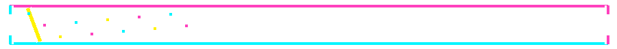</p>
<p align="center">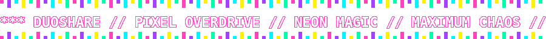</p>
<p align="center">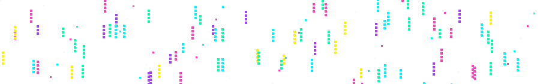</p>


<p align="center">
  <a href="https://github.com/WeiErLiTeo/DuoShare"></a>
  <a href="https://github.com/WeiErLiTeo/DuoShare/stargazers"></a>
  <a href="https://github.com/WeiErLiTeo/DuoShare/network/members"></a>
  <a href="https://github.com/WeiErLiTeo/DuoShare/issues"></a>
  <a href="https://github.com/WeiErLiTeo/DuoShare/blob/main/LICENSE"></a>
</p>

<!-- 新增：原创透明像素小人，作为页面边缘的像素 NPC。所有小人均为本包原创绘制。 -->
<p align="center">
  <sub>✦ PIXEL NPC PARADE · TRANSPARENT SPRITES · 8-BIT MAGIC ✦</sub><br />
  
  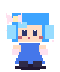
  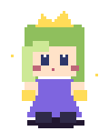
  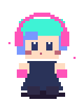
  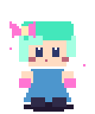
</p>
<p align="center">
  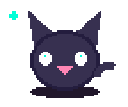
  
  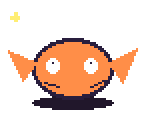
  <sub>◈ CAT.exe ◈ SLIME.exe ◈ FOX.exe ◈</sub>
</p>
<p align="center">
  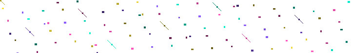
</p>
<p align="center">
  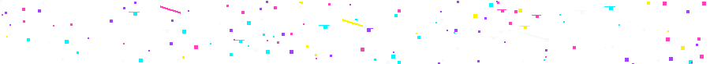
</p>

<p align="center">
  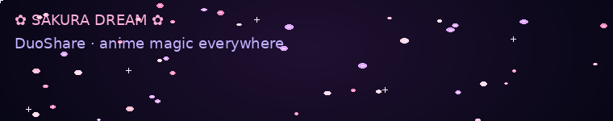
</p>

<p align="center">
  <a href="#-项目简介">🌸 项目简介</a>　✦　<a href="#-二次元-gif-放映厅">🎞️ GIF 放映厅</a>　✦　<a href="#-动态统计宇宙">📊 动态统计</a>　✦　<a href="#-贡献蛇蛇出动">🐍 贡献蛇蛇</a>　✦　<a href="#-快速开始">🚀 快速开始</a>
</p>

<p align="center">
  
</p>

## 🌸 项目简介

<p align="center">
  <strong>欢迎来到 DuoShare 的魔法小宇宙！</strong><br />
  一个用于双人共享、协作与温暖互动的小天地。<br />
  <sub>这里不走克制路线：彩虹、像素闪光、樱花、烟花、动态角色、统计卡片和贡献蛇蛇，全都安排上！</sub>
</p>

<p align="center">
  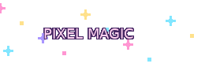
</p>
<p align="center">
  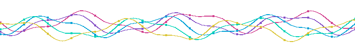
</p>

## ⚡ PIXEL OVERDRIVE：透明像素精灵出击

> 没有普通动漫截图拼贴！下面这组是专门为 DuoShare 绘制的原创像素小人循环 GIF：透明背景、像素边缘、魔法粒子，适合 README 暗色底。没有 Live2D、没有网页脚本。

<p align="center">
  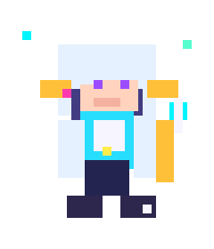
  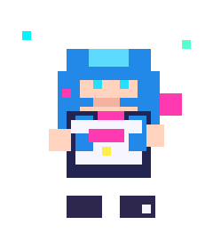
  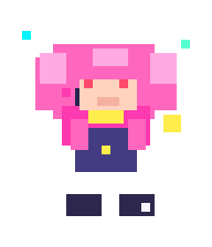
  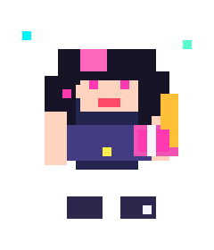
  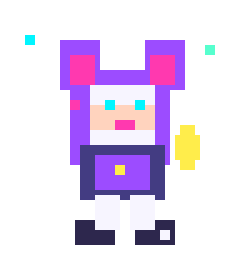
</p>

<p align="center"><sub>PIXEL PARTY · IDLE / BOB / SPARKLES · TRUE TRANSPARENT GIF BACKGROUND</sub></p>
<p align="center">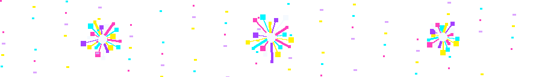</p>
<p align="center"></p>
<p align="center">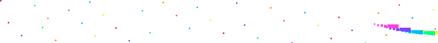</p>

## 🎀 功能特性

- 🌸 **超高二次元浓度**：薇尔莉特、芙莉莲、菲伦、蕾姆、拉姆、波奇酱、初音未来等角色 GIF。
- 🎆 **持续循环的本地特效**：樱花飘落、烟花绽放、彩虹粒子和像素闪光，不依赖网页 JavaScript。
- 🐍 **GitHub 贡献蛇蛇**：由 GitHub Actions 自动生成 GIF，并定时更新。
- 📊 **动态数据卡片**：GitHub 统计、常用语言、连续贡献、奖杯和活动图表。
- 🎨 **霓虹彩虹装饰**：动态打字标题、渐变波浪、闪光分隔线、彩色徽章和萌系访问计数。
- 🧷 **素材来源可追溯**：角色 GIF 均链接到来源页面；可运行工作流将可下载的 GIF 镜像进自己的 `image/` 目录。
- 👾 **透明像素 NPC 加量**：新增 5 个原创像素二次元小人、3 个像素宠物；包内原有的 5 个像素精灵也全部保留。
- 💥 **特效超载**：新增像素星雨、彩纸、霓虹波浪、电路流、彗星、扫描故障、魔法符文、脉冲光圈、星爆、极光等独立循环 GIF。
- 🧩 **全是可提交的本地资产**：新加的动效已经包含在 `image/` 中，不需要在 GitHub README 执行 JavaScript，也不需要你手动运行 Python 才能播放。

## 🎞️ 二次元 GIF 放映厅

> 点击角色动图可以打开对应的原始来源页面。GIF 在 GitHub README 中会循环播放；GitHub 不会执行 README 内的 JavaScript，也不会把 CSS 动画自动变成网页特效。

<table>
  <tr>
    <td align="center" width="33%"><a href="https://tenor.com/view/violet-evergarden-gif-11403745">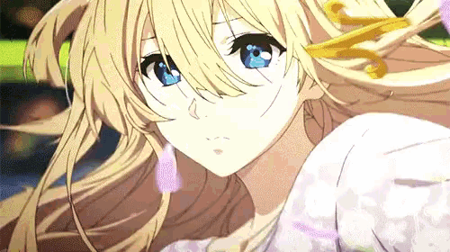</a><br /><strong>💌 薇尔莉特·伊芙加登</strong><br /><sub>Violet Evergarden · 永不褪色的信</sub></td>
    <td align="center" width="33%"><a href="https://tenor.com/view/frieren-anime-frieren-beyond-the-journeys-end-beyond-the-journeys-end-sousou-no-frieren-gif-556694785732715598">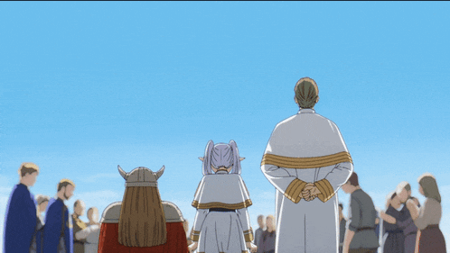</a><br /><strong>✨ 芙莉莲</strong><br /><sub>Frieren · 千年魔法使</sub></td>
    <td align="center" width="33%"><a href="https://tenor.com/view/fern-fern-frieren-fern-bread-eat-bread-eat-gif-6093318340447145323">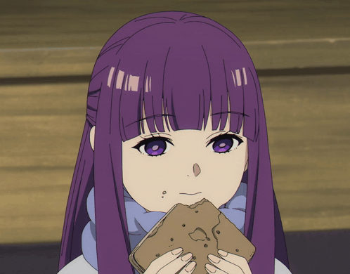</a><br /><strong>🪄 菲伦</strong><br /><sub>Fern · 认真施法中</sub></td>
  </tr>
  <tr>
    <td align="center"><a href="https://tenor.com/view/rem-gif-16729404297096831375"></a><br /><strong>💙 蕾姆</strong><br /><sub>Rem · 蓝发女仆</sub></td>
    <td align="center"><a href="https://tenor.com/view/ram-rezero-ram-re-zero-rezero-ram-re-zero-ram-ram-choke-rezero-gif-11991381440316556254">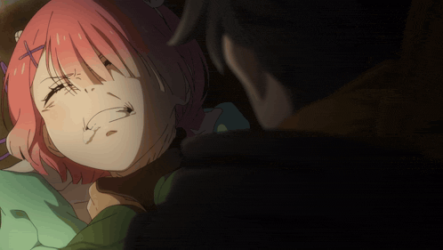</a><br /><strong>🌸 拉姆</strong><br /><sub>Ram · 粉发姐姐</sub></td>
    <td align="center"><a href="https://tenor.com/view/rem-ram-gif-21695942">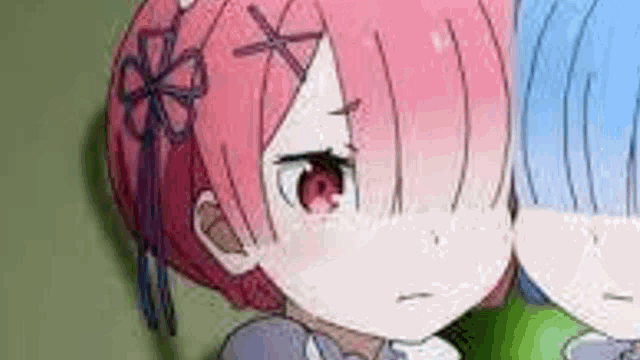</a><br /><strong>🎀 蕾姆 & 拉姆</strong><br /><sub>Rem & Ram · 双子同框</sub></td>
  </tr>
  <tr>
    <td align="center"><a href="https://tenor.com/view/bocchi-the-rock-gif-27391715">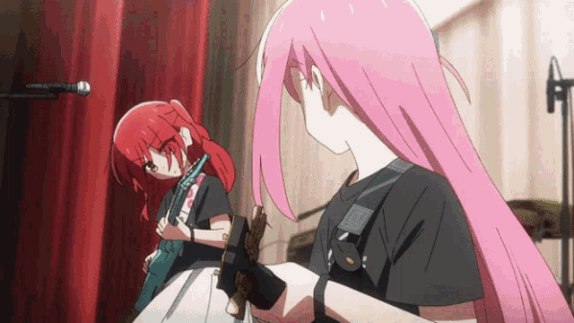</a><br /><strong>🎸 后藤一里 / 波奇酱</strong><br /><sub>Bocchi · 社恐吉他英雄</sub></td>
    <td align="center"><a href="https://tenor.com/view/anime-hatsune-miku-dancing-gif-11885930">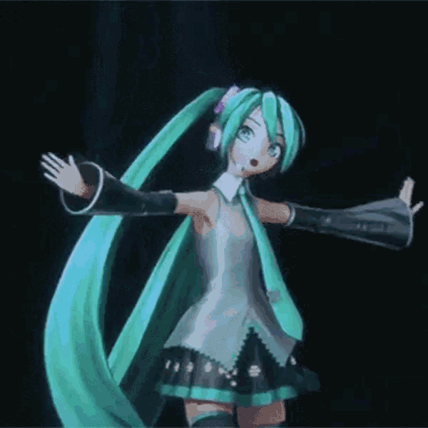</a><br /><strong>💚 初音未来</strong><br /><sub>Hatsune Miku · 音乐开场</sub></td>
    <td align="center"><a href="https://tenor.com/view/marin-kitagawa-marin-kitagawa-kitagawa-marin-bisque-gif-24606173"></a><br /><strong>💖 喜多川海梦</strong><br /><sub>Marin · 元气满满</sub></td>
  </tr>
  <tr>
    <td align="center"><a href="https://tenor.com/view/anya-forger-anya-spy-x-family-anime-forgot-gif-26756419"></a><br /><strong>🥜 阿尼亚·福杰</strong><br /><sub>Anya · 笑容与读心术</sub></td>
    <td align="center"><a href="https://tenor.com/view/chika-fujiwara-gif-20063896"></a><br /><strong>🎀 藤原千花</strong><br /><sub>Chika · 舞蹈部部长</sub></td>
    <td align="center"><a href="https://tenor.com/view/nezuko-gif-26048607">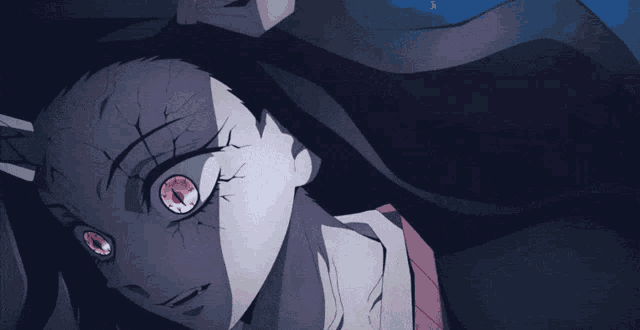</a><br /><strong>🌸 灶门祢豆子</strong><br /><sub>Nezuko · 鬼灭之刃</sub></td>
  </tr>
</table>

<p align="center">
  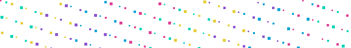
  
</p>

## 🎆 动态特效舞台

<p align="center">
  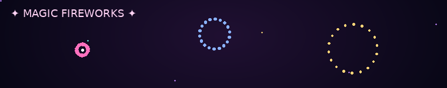
</p>
<p align="center">
  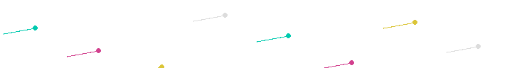
</p>

<p align="center">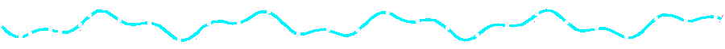</p>
<p align="center">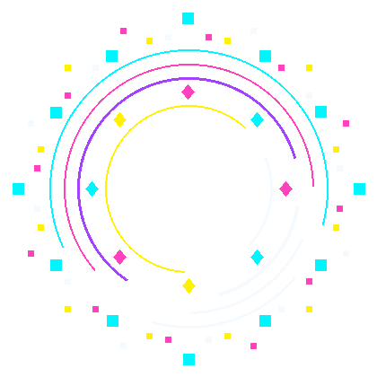</p>

## 📊 动态统计宇宙

<p align="center">
  
</p>

<p align="center">
  
</p>
<p align="center">
  
  
</p>

<p align="center">
  
</p>

<p align="center">
  
</p>

<p align="center">
  <a href="https://github.com/ashutosh00710/github-readme-activity-graph"></a>
</p>

<p align="center">
  
</p>
<p align="center">
  
</p>

## 🐍 贡献蛇蛇出动

<p align="center">
  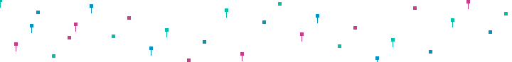
</p>

<p align="center">
  
</p>
<p align="center">
  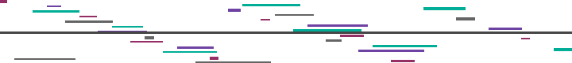
</p>

<p align="center">
  <a href="https://github.com/Platane/snk"></a>
  <a href="https://github.com/Anmol-Baranwal/Cool-GIFs-For-GitHub"></a>
</p>

<p align="center">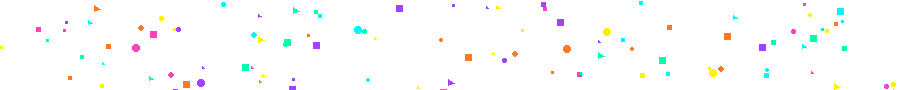</p>

## 🚀 快速开始

```bash
git clone https://github.com/WeiErLiTeo/DuoShare.git
cd DuoShare
npm install
npm start
```

> 提醒：上述启动命令沿用项目原始 README 的示例。只有在仓库确实使用 npm 且 `package.json` 定义了 `start` 脚本时才会成功；如果 DuoShare 实际是 Flutter、Kotlin 或其他项目，请以仓库真实构建说明为准。

## 🪄 自动化与素材固化

- `.github/workflows/snake.yml`：每天自动生成彩色贡献蛇 GIF，并发布到 `output` 分支。
- `.github/workflows/mirror-anime-gifs.yml`：尝试把角色 GIF 下载到仓库 `image/`，并把 README 图片链接替换为本地路径。
- `GIF_SOURCES.md`：角色 GIF 的来源页面清单。
- `image/pixel-chibi-*.gif` 与 `image/pixel-pet-*.gif`：本次新增的透明像素小人和宠物。
- `image/pixel-star-rain.gif`、`image/pixel-confetti.gif`、`image/neon-wave.gif`、`image/circuit-flow.gif`、`image/comet-trail.gif`、`image/glitch-scanlines.gif`、`image/magic-runes.gif`、`image/neon-pulse.gif`、`image/pixel-star-burst.gif`、`image/aurora-stream.gif`：本次增加的 10 种循环特效。
- `image/`：本地循环特效素材，包含樱花、烟花、彩虹粒子、透明像素小人，以及 neon / laser / pixel rain / supernova / electric / comet / confetti 等超标特效。

## 🔗 资源与维护说明

- [Platane/snk](https://github.com/Platane/snk) — 根据 GitHub 贡献日历生成蛇形 GIF / SVG。
- [Cool-GIFs-For-GitHub](https://github.com/Anmol-Baranwal/Cool-GIFs-For-GitHub) — README GIF 和头像灵感素材集合。
- [GitHub anime profile README topic](https://github.com/topics/anime-profile-readme) — 浏览更多二次元个人主页案例。
- [GitHub pixel-art topic](https://github.com/topics/pixel-art) — 搜索像素画、sprite 和精灵图相关项目。
- [GitHub pixel-animation topic](https://github.com/topics/pixel-animation) — 搜索像素动画制作与相关项目。
- [Piskel](https://github.com/piskelapp/piskel) / [Pixelorama](https://github.com/Orama-Interactive/Pixelorama) — 开源像素画与动画制作工具，可自行继续制作透明 sprite。
- [RyMe.md](https://ryme.md/) — 可生成适用于 README 的动画 SVG / GIF 横幅。
- [GitHub Cool-GIFs-For-GitHub](https://github.com/Anmol-Baranwal/Cool-GIFs-For-GitHub) — README GIF、横幅与头像资源索引；本包只参考其资源组织方式，不直接复制其中的角色图。
- [GitHub Pixel Art Topic](https://github.com/topics/pixel-art) — 像素艺术、精灵表与像素编辑器项目索引。
- [GitHub Animated Sprites Topic](https://github.com/topics/animated-sprites) — 动画精灵与 GIF 制作项目索引。
- [Piskel](https://github.com/piskelapp/piskel) — 开源像素绘图/动画工具，可制作精灵表并导出 GIF。
- `effects/` 与 `image/pixel-sprites/` 中的新增特效及小人是本包本地生成的原创视觉素材，不依赖上述仓库的外链。

<p align="center">
  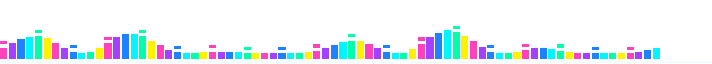
</p>
<p align="center">
  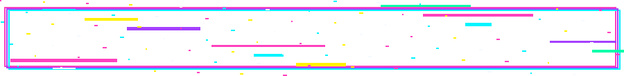
</p>
<p align="center">
  
</p>

<p align="center">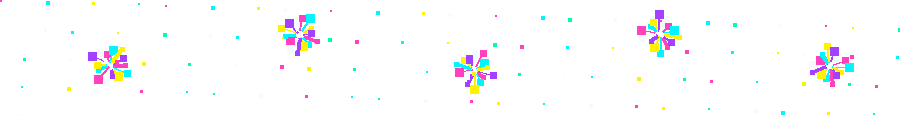</p>
<p align="center"><strong>🌸 またね！ See you in the next commit! 🌸</strong></p>
